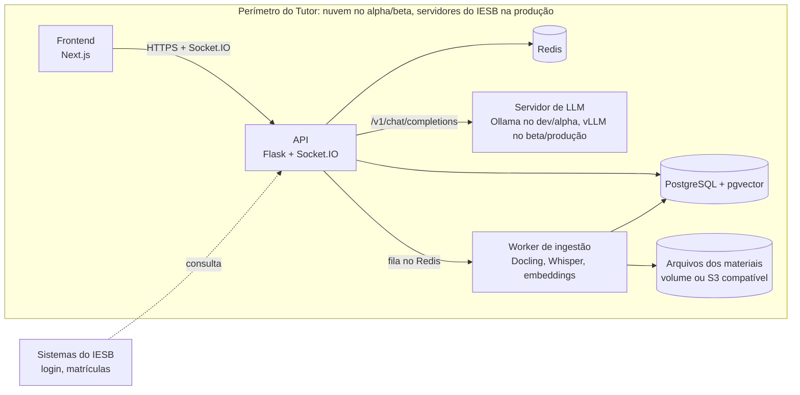

# Arquitetura do Tutor

> **Status:** proposta v1 (out/2026). Vira vigente quando aprovada pelo líder e pela coordenação do CRIA.
> **Como muda:** só por PR neste arquivo, com aprovação do líder (`.github/CODEOWNERS`). Código que contraria este documento não entra.

## 1. Restrições

| # | Restrição | Origem |
|---|---|---|
| R1 | Tudo *in-house*: nenhum serviço externo de LLM (OpenAI, Gemini, AWS Bedrock…). Modelos abertos, servidos por nós. | coordenação |
| R2 | Alpha e beta em nuvem; produção nos servidores do IESB. O mesmo sistema roda nos dois sem reescrita. | coordenação |
| R3 | Sem alucinação: nenhuma resposta sem fonte verificável no material da matéria. | coordenação; visão RN-01, RN-09, RN-11 |
| R4 | Sem vazamento de dados de alunos: dado pessoal é consultado no IESB ou, se guardado, minimizado e pseudonimizado; o que vai para análise é anonimizado. | coordenação; LGPD; visão RNF-18 a 21 |
| R5 | Pode haver custo de licença de bases de conhecimento para melhorar a assertividade. | coordenação |

## 2. Visão geral

| Componente | Tecnologia | Nota |
|---|---|---|
| Frontend | Next.js 16 + TypeScript | já existe |
| API | Flask + Flask-SocketIO (gunicorn/gevent) | regra de negócio em `services/` |
| Banco | PostgreSQL 16 + pgvector | relacional e vetores no mesmo banco; ChromaDB não é usado |
| Redis | denylist de tokens, fila do Socket.IO, fila de ingestão | com senha, sem porta pública |
| Servidor de LLM | Ollama (dev/alpha) → vLLM (beta/produção) | os dois falam o protocolo `/v1/chat/completions`: trocar é configuração (`LLM_BASE_URL`) |
| Embeddings e reranker | modelos locais multilíngues (sentence-transformers, já é dependência) | ver D-03 |
| Ingestão | worker separado consumindo fila no Redis | falha na ingestão não derruba o chat (RNF-10) |
| Arquivos | volume persistente ou armazenamento S3 compatível (MinIO) | hoje os uploads se perdem a cada restart |

## 3. Contrato de resposta (anti-alucinação)

Nenhum modelo de linguagem garante sozinho "zero alucinação". O que o Tutor garante, e testa, é outra coisa: **nenhuma resposta chega ao aluno sem estar presa a trechos do material da matéria.** Quando não dá para sustentar, recusa e escala ao professor (RN-03, RN-11).

Cada etapa pode barrar a resposta:

1. **Escopo.** A busca vetorial filtra no SQL pela turma e matéria do aluno (RN-01, RN-05, RNF-17). A pergunta nunca enxerga material de outra matéria.
2. **Evidência mínima.** Busca os 20 chunks mais próximos, reordena com um reranker multilíngue (ex.: `BAAI/bge-reranker-v2-m3`) e fica só com os acima do limiar `τ`. Se nenhum passar, **a LLM nem é chamada**: o aluno recebe a mensagem padrão e a dúvida vai para o professor.
3. **Geração presa às fontes.** O prompt de sistema é fixo e mora no servidor. Ele manda responder só com os trechos numerados, citar `[n]` em cada afirmação e devolver exatamente `SEM_BASE` quando os trechos não bastarem. Temperatura ≤ 0,2. O histórico (últimas 10 trocas, RN-06) é lido do banco, nunca do cliente.
4. **Verificação antes de mostrar.** A resposta vem em JSON com esquema (`resposta`, `citacoes`); os dois servidores de LLM suportam saída estruturada. A resposta é recusada se vier sem citação, se citar trecho que não foi recuperado ou se vier `SEM_BASE`. Fase 2: um modelo verificador local confere se cada frase é sustentada pelos trechos citados.
5. **Transparência.** O aluno vê as fontes de cada resposta (material e página ou minuto), o que cumpre a RN-09. O botão "resposta errada" manda o caso para a fila do professor.

Consequência: a resposta aparece inteira depois de verificada, sem streaming token a token. O limite de 30 s (RNF-01) continua valendo, e o "digitando…" cobre a espera.

**Ingestão para isso funcionar:** chunks de ~500–800 tokens com sobreposição, cada um com material, página ou minuto e posição, e licença quando vier de base licenciada.

**Avaliação.** Nenhuma troca de modelo, prompt, chunking, embedding ou limiar sobe sem passar no conjunto de ouro:
- por matéria piloto, ≥ 50 perguntas com resposta e trecho esperados e ≥ 20 perguntas sem resposta no material;
- meta: 100% das perguntas sem resposta recusadas e nenhuma afirmação sem sustentação nas respondidas. Toda falha encontrada no uso vira caso novo do conjunto;
- roda no servidor com GPU do alpha (os runners do GitHub não têm GPU), e o relatório vai anexado ao PR.

## 4. Dados pessoais e segurança (LGPD)

Princípio: o Tutor guarda o mínimo, e nada sai do perímetro.

| Dado | Fonte da verdade | O que o Tutor guarda | Regra |
|---|---|---|---|
| Identidade (nome, matrícula, e-mail) | IESB | o mínimo para login e autorização. Alvo: consultar no IESB no login e guardar só um ID interno | nunca em log |
| Turmas e matrículas | IESB | vínculo aluno ↔ turma (alvo: sincronizado do IESB, só leitura) | — |
| Conversas | Tutor | ligadas ao ID interno, nunca a nome ou matrícula. CPF, e-mail, telefone e matrícula digitados pelo aluno são mascarados antes de gravar | retenção definida com o encarregado (DPO); exclusão a pedido (RNF-20) |
| Painéis e análises | derivados | só agregados anônimos; grupo com menos de 5 alunos não aparece | sem identificação individual |
| Logs | — | IDs técnicos, rota, status, tempo | nunca conteúdo, e-mail, matrícula, token ou senha |
| Testes e avaliação | — | só dados fictícios ou anonimizados | — |
| Materiais | professor | arquivos e chunks | professor não sobe material com dado pessoal de aluno |

Termos da LGPD: **anonimizado** é o dado que não volta mais à pessoa e por isso deixa de ser dado pessoal (art. 12). **Pseudonimizado** é o que só volta à pessoa com uma informação guardada à parte (art. 13, §4) e continua sendo dado pessoal. A conversa que o aluno revê é pseudonimizada, não anônima; por isso tem retenção e controle de acesso.

Regras técnicas:
- **Nada sai do perímetro.** LLM, embeddings, transcrição e OCR rodam localmente. O e-mail sai pelo SMTP do IESB, não por Gmail pessoal, e o login usa o provedor institucional.
- Pesos de modelos são baixados uma vez pela equipe, verificados e servidos internamente. Em produção não há download em tempo de execução (Ollama, Hugging Face, WebDriver).
- TLS em tudo; cookie `Secure` e `httpOnly`; banco e backups criptografados; Postgres, Redis e servidor de LLM sem porta pública.
- Toda rota e o socket exigem token (exceto login, convite e recuperação de senha). A permissão é checada no backend, não só no frontend.
- Ferramentas externas (ffmpeg etc.) rodam sem shell, com lista de argumentos. O scraping de links só acessa domínios permitidos e nunca endereços internos.
- Dev e alpha usam só dados fictícios. **Beta com alunos reais só depois de:** D-01 cumprida, RIPD aprovado pelo encarregado do IESB e nuvem em região no Brasil.

## 5. Ambientes

| | dev | alpha | beta | produção |
|---|---|---|---|---|
| Onde | máquina do dev | nuvem (VM com GPU) | nuvem, região Brasil | servidores do IESB |
| Quem usa | dev | equipe | turmas piloto | todos |
| Dados | fictícios | fictícios | reais, com RIPD aprovado | reais |
| LLM | Ollama, modelo pequeno | Ollama | vLLM | vLLM |
| Orquestração | docker compose | docker compose | a definir com a TI do IESB | o que a TI do IESB operar |

## 6. Decisões

| ID | Decisão | Status |
|---|---|---|
| D-01 | **LLM só interna**, pelo protocolo `/v1/chat/completions` em `LLM_BASE_URL`. Proibida qualquer API de LLM de terceiros, inclusive "só no alpha". | proposta |
| D-02 | **Modelo aberto escolhido por avaliação** (seção 3), com licença que permita uso institucional (preferir Apache-2.0 ou MIT; ler os termos de Llama e Gemma antes). Referência de hardware: modelos de 7–14 B quantizados rodam numa GPU de 24 GB; o tamanho final sai do teste de carga do beta (RNF-02 pede 500 usuários simultâneos). Em produção, o catálogo do admin (EP-09) só lista modelos já aprovados e baixados pela equipe. | proposta |
| D-03 | **Embeddings multilíngues** no lugar do `all-MiniLM-L6-v2` (treinado para inglês e truncado em ~256 tokens), escolhidos pelo mesmo eval. Candidatos com licença MIT: `BAAI/bge-m3` e `intfloat/multilingual-e5-large`. Trocar o modelo exige reindexar, porque a dimensão do vetor muda. | proposta |
| D-04 | **pgvector como única base vetorial**, criada por migration Alembic (hoje é um script manual), índice HNSW e imagem `pgvector/pgvector:pg16` no compose. | proposta |
| D-05 | **Contrato de resposta** da seção 3; a resposta é exibida depois de verificada. | proposta |
| D-06 | **Dados pessoais** conforme a seção 4. | proposta |
| D-07 | **Portabilidade:** só componentes open source em contêiner, configuração por variável de ambiente e nenhum serviço gerenciado proprietário no caminho crítico. Arquivos por volume ou API S3 compatível. | proposta |
| D-08 | **Ingestão em worker separado.** O upload só enfileira; o worker extrai, faz chunks, gera embeddings e indexa. | proposta |
| D-09 | **Bases licenciadas** (R5) entram como material de uma matéria, com licença e procedência em cada chunk. Só contratar com cláusula que permita uso por IA (mineração de texto e RAG) e guarda local de embeddings; muitas bibliotecas digitais proíbem, então validar com a biblioteca e o jurídico do IESB antes de orçar. | proposta |
| D-10 | **Camadas do backend:** entrada (`routes/`, `socket/`) → `services/` → `models/`. Rota e socket não acessam model nem `db`. Integrações (LLM, e-mail, Docling, Whisper) ficam em `libs/` e são chamadas por services. A CI garante com `backend/.importlinter`. | vigente |
| D-11 | **Fluxo de código:** trunk-based na `main`, PR obrigatório, squash, padrões e checks do `CONTRIBUTING.md`. | vigente |

## 7. Estado atual vs. alvo (`main` em 10/10/2026)

**P0** = resolver antes de qualquer aluno real usar o sistema. Caminhos relativos a `backend/application/`.

| Tema | Hoje | Alvo | Prioridade |
|---|---|---|---|
| Geração | AWS Bedrock (Llama 3 8B, us-east-1, temperatura 0,7) em `socket/Impl/gerar_resposta.py`: perguntas, histórico e material saem do país | D-01 | **P0** |
| Socket do chat | `socket/event_handler.py:51` aceita o `id_usuario` enviado pelo cliente; `_autenticar_handshake` nunca é chamado | JWT obrigatório no handshake | **P0** |
| Rotas com dados | `GET /alunos/buscar` e `GET /mensagens/chat/<id>` respondem sem login; papéis comentados em `routes/route_vinculos.py` | autenticadas, com dono e papel checados | **P0** |
| Transcrição | `libs/whisper_handler.py:16` monta o comando do ffmpeg com o nome do arquivo e roda com `os.system` (injeção de comando) | `subprocess` sem shell | **P0** |
| Busca | top-5 sem limiar; erros viram lista vazia (`socket/Impl/busca_semantica.py`) | seção 3, etapa 2 | P1 |
| Chunking | nenhum: um embedding por documento inteiro, que ainda é truncado | chunks com página ou minuto | P1 |
| Embeddings | `all-MiniLM-L6-v2` (inglês), 384 dimensões | D-03 | P1 |
| Citação e recusa | o prompt pede citação, mas os trechos vão sem ID; a recusa está comentada; não há verificação | seção 3 | P1 |
| Histórico | vem do cliente e entra no prompt (injeção de prompt) | lido do banco | P1 |
| Logs | `print` com conteúdo de mensagem, e-mail e nome de arquivo; `str(e)` devolvido ao cliente | logs sem PII | P1 |
| Infra | compose sem pgvector; k8s sem servidor de LLM nem GPU; uploads sem volume; deploy no EKS do Bayarea | D-04, D-07 | P1 |
| Mensagens longas | `mensagens.conteudo` é `varchar(3200)`, mas a resposta pode ter até 4096 tokens | `text` | P2 |

## 8. Pendências

- Hardware de GPU para produção no IESB e quem o opera (TI do IESB).
- Integração com os sistemas acadêmicos do IESB: API ou view somente leitura para identidade e matrículas.
- Provedor e orçamento da nuvem do alpha/beta (GPU, região Brasil).
- Bases licenciadas: quais, quanto custam e se têm cláusula de uso por IA.
- Retenção das conversas, base legal e RIPD (encarregado/DPO do IESB).
- Modelo, embeddings e limiar `τ` finais: saem do eval no alpha.
